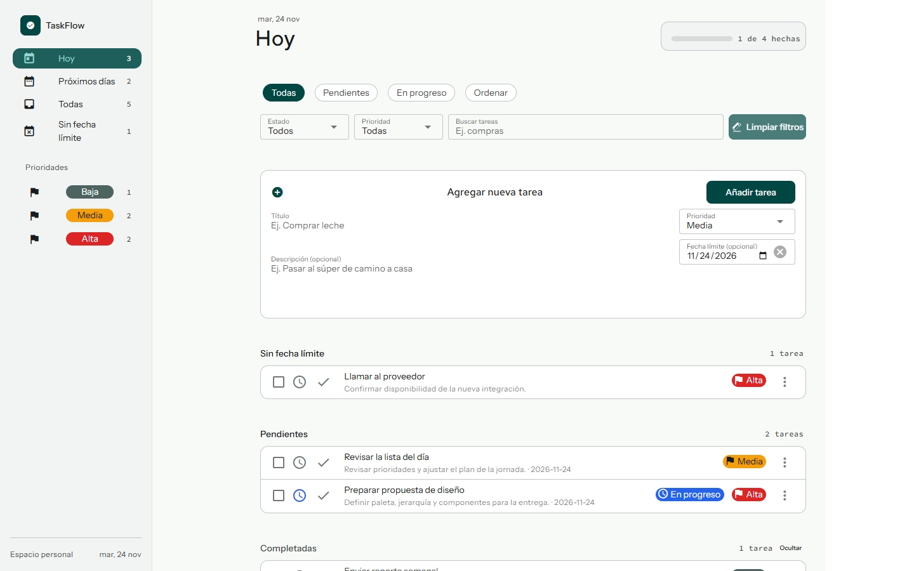
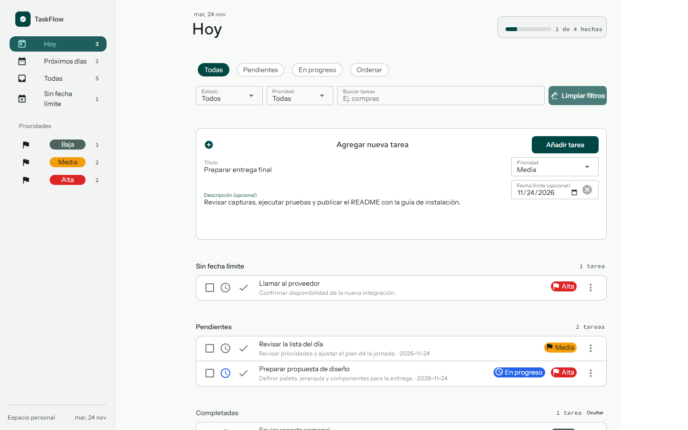
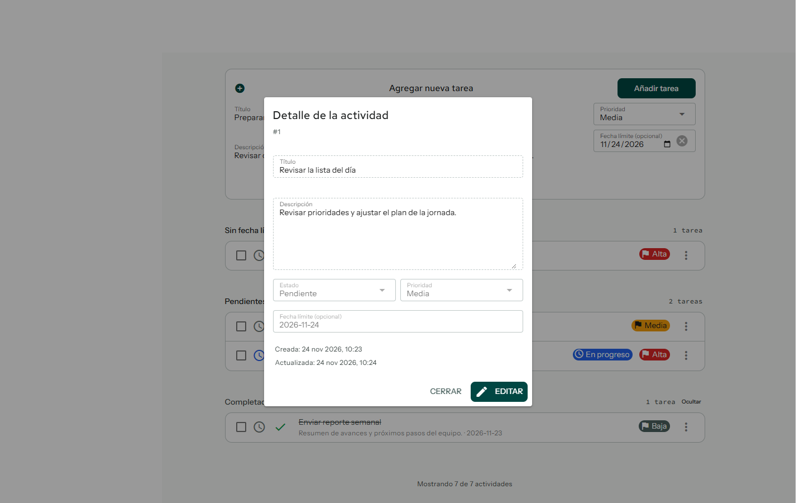
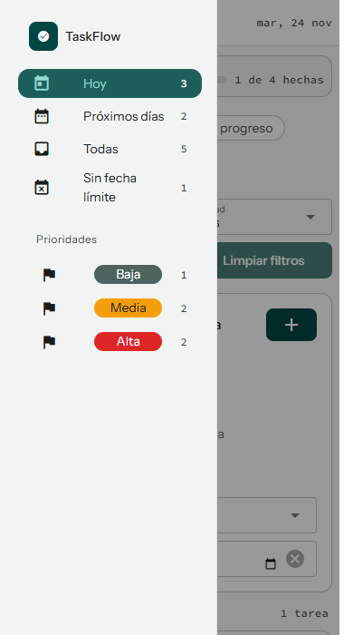

# TaskFlow

Gestor de actividades personales o de equipo. Incluye una **API REST con Laravel 12 y SQLite** y una **SPA con Quasar, Vue 3 y TypeScript**. Puedes crear, consultar, editar, cambiar de estado y eliminar tareas con confirmación, además de buscarlas y filtrarlas. No requiere autenticación ni gestión de usuarios.

Repositorio: https://github.com/RomanVazq/Desafio_Tecnico.git

---

## Índice

- [Requisitos](#requisitos)
- [Instalación](#instalación)
- [Uso](#uso)
- [API REST](#api-rest)
- [Verificación](#verificación)
- [Estructura del repositorio](#estructura-del-repositorio)
- [Decisiones técnicas](#decisiones-técnicas)
- [Capturas](#capturas)
- [Autor](#autor)

---

## Requisitos

- **Git**, **PHP 8.2 o superior** y **Composer 2.2 o superior**.
- Extensiones de PHP: `pdo_sqlite` para la base local y las pruebas; verifica también `mbstring`, `fileinfo`, `openssl`, `dom`, `xml` y `xmlwriter` para Laravel y sus dependencias. `php --ini` indica qué `php.ini` usa la terminal.
- **Node.js 22.12 o superior** (se recomienda una versión LTS) y **pnpm 10.26.1**. Se usa el `pnpm-lock.yaml` del repositorio; npm solo se necesita si vas a usarlo para instalar pnpm.
- Puertos locales **8000** (Laravel) y **8080** (Vite) disponibles. No hace falta instalar un servidor de base de datos: SQLite usa un archivo local.

Si todavía no tienes pnpm:

```sh
npm install --global pnpm@10.26.1
pnpm --version
```

---

## Instalación

### Clonar el repositorio

```powershell
git clone https://github.com/RomanVazq/Desafio_Tecnico.git
cd Desafio_Tecnico
```

Cada bloque que empieza con `cd backend` o `cd frontend` parte de la raíz `Desafio_Tecnico/`. Mantén cada servidor en su propia terminal.

### Backend: terminal 1

Solo para la primera configuración:

```sh
cd backend
composer install
php -r "is_file('.env') || copy('.env.example', '.env');"
php artisan key:generate
php artisan migrate
php artisan serve --host=127.0.0.1 --port=8000
```

Cuando `migrate` pregunte si desea crear `backend/database/database.sqlite`, responde `sí`/`yes`. El [`backend/.env.example`](backend/.env.example) ya define `DB_CONNECTION=sqlite`, así que no hace falta configurar `DB_DATABASE`, y `storage/framework/views` ya viene en el repositorio mediante un `.gitkeep` para que las pruebas funcionen desde el clon. En ejecuciones posteriores solo vuelve a iniciar el servidor desde `backend/`; no regeneres `APP_KEY`.

La API queda en **http://127.0.0.1:8000/api**. Abre [el endpoint de salud](http://127.0.0.1:8000/api/health): debe devolver `200` con `"status": "ok"`. La base empieza vacía; si quieres una tarea de ejemplo, ejecuta `php artisan db:seed` desde `backend/` antes de iniciar el servidor.

### Frontend: terminal 2

Abre otra terminal en la raíz del repositorio y ejecuta:

```powershell
cd frontend
pnpm install --frozen-lockfile
Copy-Item .env.example .env
pnpm dev --host 127.0.0.1
```

> En Linux/macOS, reemplaza `Copy-Item .env.example .env` por `cp .env.example .env`. Si ya tienes un `.env` configurado, omite la copia.

El [`frontend/.env.example`](frontend/.env.example) ya apunta al backend local:

```env
VITE_API_URL=http://127.0.0.1:8000/api
```

Abre **[http://127.0.0.1:8080](http://127.0.0.1:8080)**. La raíz redirige a `/activities`.

- **Si la SPA no se conecta:** abre primero `/api/health` y confirma que la API siga ejecutándose. Si cambias el puerto del backend, actualiza `VITE_API_URL` y vuelve a iniciar Vite.
- **Si cambias el origen de la SPA:** agrega el nuevo origen a `CORS_ALLOWED_ORIGINS` en `backend/.env` y vuelve a iniciar Laravel. La configuración inicial permite `http://127.0.0.1:8080` y `http://localhost:8080`.
- **Si Laravel dice `could not find driver`:** habilita `pdo_sqlite` en el `php.ini` que indica `php --ini` y vuelve a iniciar el servidor.

---

## Uso

1. Crea una tarea desde **Agregar nueva tarea**. El título es obligatorio; la descripción y la fecha límite son opcionales. Si conservas la fecha de hoy, la verás en **Hoy**. Si quitas la fecha, búscala en **Sin fecha límite** o **Todas**.
2. Para buscar por título o descripción entre todas las fechas, selecciona **Todas** en el menú lateral. Usa **Estado** y **Prioridad** para filtrar en la API; los chips filtran las tareas abiertas de la vista o las ordenan por prioridad.
3. Abre `⋮` para **Ver detalle**, **Editar** o **Eliminar**. El reloj cambia el estado a **En progreso** y la palomita a **Completada**; si pulsas otra vez el mismo control activo, vuelve a **Pendiente**.
4. Para eliminar varias tareas, marca sus casillas, pulsa **Eliminar selección** y confirma. Cancelar no borra nada.

**Cargar más** acumula páginas de 15 tareas. Al cambiar los filtros de la API se consulta de nuevo la página 1; la paginación queda bloqueada mientras se resuelve la búsqueda. Los contadores laterales muestran las tareas abiertas entre los resultados cargados.

---

## API REST

Base URL: `http://127.0.0.1:8000/api`

| Método | Ruta | Descripción | Código |
|---|---|---|---:|
| `GET` | `/health` | Estado del servicio | 200 |
| `GET` | `/activities` | Listado paginado (15 por página) | 200 |
| `GET` | `/activities?page=2` | Página siguiente (Laravel pagina automáticamente) | 200 |
| `GET` | `/activities?q=leche&status=pendiente` | Búsqueda y filtro | 200 |
| `GET` | `/activities?priority=alta&status=pendiente` | Prioridad y estado combinados | 200 |
| `GET` | `/activities/{id}` | Detalle | 200 |
| `POST` | `/activities` | Crear | 201 |
| `PATCH` | `/activities/{id}` | Editar (parcial) | 200 |
| `DELETE` | `/activities/{id}` | Eliminar | 200 |

### Listar

```bash
curl "http://127.0.0.1:8000/api/activities?q=leche&status=pendiente"
```

```json
{
  "data": [
    {
      "id": 3,
      "title": "Comprar leche",
      "description": "Pasar por la estación",
      "status": "pendiente",
      "priority": "media",
      "due_date": "2026-11-30",
      "created_at": "2026-11-24T15:30:00.000000Z",
      "updated_at": "2026-11-24T15:30:00.000000Z"
    }
  ],
  "links": { "first": "...", "last": "...", "prev": null, "next": null },
  "meta": { "current_page": 1, "from": 1, "last_page": 1, "per_page": 15, "to": 1, "total": 1 }
}
```

### Filtrar por prioridad y estado

```bash
curl "http://127.0.0.1:8000/api/activities?priority=alta&status=pendiente"
```

Devuelve solo las actividades con prioridad `alta` y estado `pendiente`. Los valores válidos para `priority` son `baja`, `media` y `alta`. Un valor inválido responde `422`.

### Crear

```bash
curl -X POST http://127.0.0.1:8000/api/activities \
  -H "Accept: application/json" \
  -H "Content-Type: application/json" \
  -d '{"title":"Preparar demo","description":"Cargar capturas","status":"pendiente","priority":"alta","due_date":"2026-11-30"}'
```

```json
{
  "data": {
    "id": 4,
    "title": "Preparar demo",
    "description": "Cargar capturas",
    "status": "pendiente",
    "priority": "alta",
    "due_date": "2026-11-30",
    "created_at": "2026-11-24T10:30:00.000000Z",
    "updated_at": "2026-11-24T10:30:00.000000Z"
  },
  "message": "Actividad creada correctamente."
}
```

### Ver detalle

```bash
curl http://127.0.0.1:8000/api/activities/4
```

```json
{
  "data": {
    "id": 4,
    "title": "Preparar demo",
    "description": "Cargar capturas",
    "status": "pendiente",
    "priority": "alta",
    "due_date": "2026-11-30",
    "created_at": "2026-11-24T10:30:00.000000Z",
    "updated_at": "2026-11-24T10:30:00.000000Z"
  }
}
```

### Editar

```bash
curl -X PATCH http://127.0.0.1:8000/api/activities/4 \
  -H "Accept: application/json" \
  -H "Content-Type: application/json" \
  -d '{"status":"completada"}'
```

```json
{
  "data": {
    "id": 4,
    "title": "Preparar demo",
    "description": "Cargar capturas",
    "status": "completada",
    "priority": "alta",
    "due_date": "2026-11-30",
    "created_at": "2026-11-24T10:30:00.000000Z",
    "updated_at": "2026-11-24T10:36:00.000000Z"
  },
  "message": "Actividad actualizada correctamente."
}
```

### Eliminar

```bash
curl -X DELETE http://127.0.0.1:8000/api/activities/4
```

```json
{ "message": "Actividad eliminada correctamente." }
```

### Error de validación (422)

```json
{
  "message": "El título es obligatorio.",
  "errors": { "title": ["El título es obligatorio."] }
}
```

---

## Verificación

Ejecuta cada bloque desde la raíz del repositorio. No hace falta iniciar los servidores: las pruebas usan SQLite en memoria y el build es estático.

**Backend** (terminal 1):

```sh
cd backend
php artisan test
```

**Frontend** (terminal 2):

```sh
cd frontend
pnpm build
```

Verificación realizada en un clon limpio con PHP 8.2.12, Composer 2.8.10, Node 24.12.0 y pnpm 10.26.1:

- Backend: `Tests: 17 passed (62 assertions)`. El filtro `php artisan test --filter=ActivityApiTest` reporta `15 passed (60 assertions)`.
- Frontend: `✓ 179 modules transformed`, `✓ built`.

---

## Estructura del repositorio

```text
Desafio_Tecnico/
├── backend/                         # API Laravel 12 + SQLite
│   ├── app/Http/Controllers/Api/ActivityController.php
│   ├── app/Http/Requests/            # Index, Store y Update ActivityRequest
│   ├── app/Http/Resources/           # ActivityResource y ActivityCollection
│   ├── app/Models/Activity.php
│   ├── database/migrations/          # Migración de activities
│   ├── routes/api.php
│   └── tests/Feature/ActivityApiTest.php
├── frontend/                        # SPA Quasar + Vue 3 + TypeScript
│   └── src/modules/activities/
│       ├── pages/ActivitiesPage.vue
│       ├── components/               # Sidebar, filtros, filas, formularios y diálogo
│       ├── composables/              # useActivities y useActivityViews
│       ├── services/                 # api.ts y activityRepository.ts
│       ├── types/activity.types.ts
│       └── constants/
├── docs/screenshots/                # Capturas reales de la SPA
└── README.md
```

---

## Decisiones técnicas

| Decisión | Motivo |
|---|---|
| **SQLite** | No requiere servidor de base de datos; el archivo se crea con los comandos de instalación. |
| **Form Requests** | Validación fuera del controlador, con mensajes en español y respuestas `422` consistentes. |
| **Resources y colecciones** | Toda la API usa `data`, y el listado añade `links` y `meta`. |
| **Filtros en backend** | `q`, `status` y `priority` se validan y aplican en Laravel antes de paginar; los chips son solo vistas locales. |
| **Repositorio inyectable** | `useActivities(repository)` separa HTTP, estado y UI; permite probar sin red. |
| **Vistas derivadas** | `useActivityViews` agrupa por fecha y estado, ordena y calcula contadores sin duplicar lógica en la plantilla. |
| **Paginación progresiva** | «Cargar más» solicita la página siguiente y deduplica por `id`. |
| **Sin autenticación** | El alcance pedido es el CRUD; no hay usuarios, login ni permisos. |
| **TaskFlow Calm** | Paleta pino-teal, sage-slate y terracota; colores de estado y prioridad definidos en un solo lugar. |
| **pnpm fijado** | `packageManager` en `package.json` y `pnpm-lock.yaml` hacen reproducible la instalación del frontend. |

---

## Capturas

Capturas reales de la SPA con datos de ejemplo aislados. Los archivos están en [`docs/screenshots/`](docs/screenshots/).



*Vista desktop: menú lateral, progreso diario y secciones «Sin fecha límite», «Pendientes» y «Completadas».*



*Alta rápida con título, descripción, prioridad y fecha límite.*



*Detalle de una tarea con fechas de creación y actualización formateadas.*



*Pantalla pequeña con el menú lateral abierto.*

---

## Autor

**Roman Vázquez** — [@RomanVazq](https://github.com/RomanVazq)

Desafío técnico: API REST + SPA con Laravel y Quasar.
